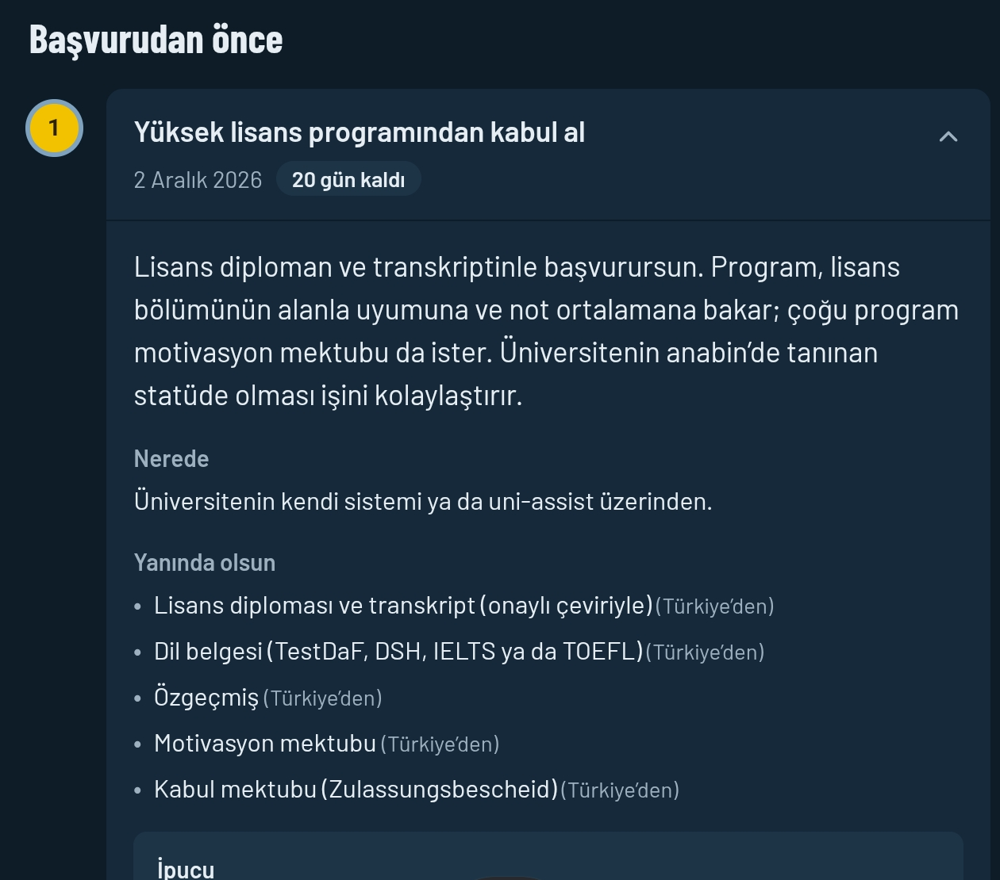
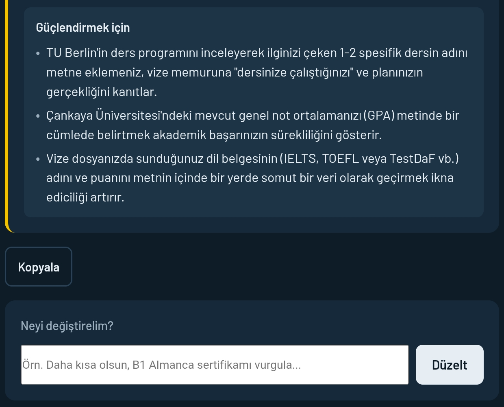

# Ankommen

**Türkiye’den Almanya’ya öğrenim ya da iş için taşınanlara, resmî işlerini kendi tarihlerine göre sıralayan kişisel rehber.**

*Ankommen*, Almancada “varmak” demek.

🔗 **Canlı prototip (Gemini Canvas):** https://share.gemini.google/FAJgxzcCEMkf
Açılan ekranda “Deneyin” düğmesine basmanız yeterli.

## Sorun

Almanya’ya taşınacak biri için bilgi eksik değil, dağınık. Kurallar resmî portallar, temsilcilik, üniversite, sigorta şirketi ve şehrin kendi sitesi arasında bölünmüş; işlemler de birbirine bağlı. Banka hesabı için adres kaydı, adres kaydı için ev sahibi onayı gerekiyor. Sırayı bilmeyen kişi haftalar kaybediyor.

## Ne yapıyor?

- **Kişisel yol haritası:** Gidiş amacını (dil okulu, lisans, yüksek lisans, çalışma), şehri ve varış tarihini seçersin; adımlar gerçek tarihleriyle sıralanır.
- **Sıradaki adım:** Ön koşulları tamamlanmış en yakın iş her zaman en üstte görünür.
- **Adım ayrıntısı:** Ne yapılacağı, nereye gidileceği, hangi belgelerin gerektiği, ipucu, Almanca terimler ve resmî kaynak bağlantısı.
- **Belge çantası:** Bütün belgeler tek listede, “Türkiye’den hazırla” ve “Almanya’da alacaksın” diye ayrılmış.
- **Bütçe:** Seçilen yola göre 2026 resmî tutarları.
- **Mektup yazıcı:** Gemini ile kişiye özel motivasyon mektubu, iş başvurusu ön yazısı ya da ev sahibine tanıtım mesajı taslağı.
- **16 şehir:** Berlin, Münih, Hamburg, Köln, Frankfurt, Stuttgart, Düsseldorf, Leipzig, Dresden, Nürnberg, Hannover, Bremen, Dortmund, Aachen, Heidelberg, Münster.

## Dokümanlar

- [Tasarım dokümanı](tasarim.md): ilkeler, renkler, tipografi, bileşenler ve veri yapısı.

Uygulamanın kaynak kodu ve doğrulanmış içerik dosyası gizli bir depoda tutuluyor.

## Durum

- Çalışan prototip, herkese açık bağlantı
- İlk kullanıcı testi: 3 kişi; en çok beğenilen özellik mektup yazıcı
- Gemini Prompt Arena’ya başvuruldu (Kasım 2026)

## Yol haritası

- **Ay 1–2:** Kendi alan adında web uygulaması, içeriğin bir uzmana kontrol ettirilmesi, 20 kişiyle kullanıcı testi
- **Ay 3:** Google Play’de Android sürümü
- **Ay 4–5:** Son tarih bildirimleri, Almanca resmî mektupları açıklayan araç
- **Ay 6:** Aile birleşimi, Chancenkarte ve Ausbildung yolları

## Not

Ankommen bilgilendirme amaçlıdır; hukuki danışmanlık değildir. Kurallar şehre ve kişisel duruma göre değişebilir. Her adımı ilgili resmî kaynaktan doğrulayın.

## Geliştiren

Elif Hacımustafaoğlu · Çankaya Üniversitesi Bilgisayar Mühendisliği
Fikir ve planlama aşamasında Claude ile, uygulamanın güncel sürümü Gemini Canvas ile geliştirildi.

© 2026 Elif Hacımustafaoğlu. Tüm hakları saklıdır.
